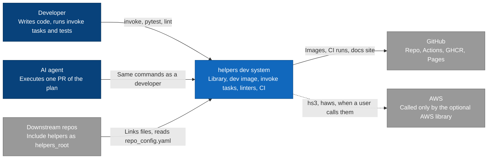
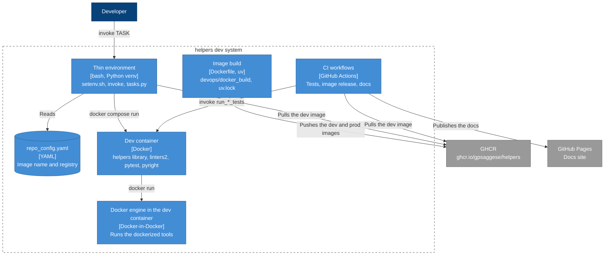

# Design: Architecture of the Helpers Dev System

- Generated by `.claude/skills/architecture.write_design/SKILL.md`

## Goal

- Describe the parts of the `helpers` dev system that the cleanup changes, today
  and after the cleanup
  - The dev system is how a developer, an AI agent, or CI builds the image, runs the
    invoke tasks, runs the tests, and publishes the docs
  - The cleanup changes the dev system, not the library code: the Python modules
    under [`helpers/`](/helpers/) keep their design
- This doc is short on purpose: the cleanup removes and renames code, it does not
  build a new component
  - Add a component doc `02.<N>-design.<component>.md` only when a PR needs a design,
    e.g., the container user, see
    [`D16`](/docs/projects/cleanup/03-decisions.md#d16-create-the-container-user-in-the-entrypoint)
- **Where it fits**: [`01-prd.md`](/docs/projects/cleanup/01-prd.md) -> this doc ->
  [`04-plan.md`](/docs/projects/cleanup/04-plan.md)
- **Decisions**: [`03-decisions.md`](/docs/projects/cleanup/03-decisions.md)

## Diagram

### C4 Refresher

- C4 draws a system at four levels: each level zooms into one box of the level above
  - **C1 (Context)**: the system as one box, with its users and the external systems
    around it. Question: who uses the system, and what does it depend on?
  - **C2 (Container)**: the parts of the system that run or store data on their own
    (e.g., app, service, script, DB), and how they call each other. Question: what is
    the system made of, and with which technology?
  - **C3 (Component)**: the parts inside one container (e.g., modules, classes).
    Question: how is one container organized?
  - **C4 (Code)**: the classes and functions inside one component. Not drawn: the
    code is the diagram
- The diagrams are Mermaid flowcharts with the C4 colors, so that GitHub renders
  them in the PR, see
  [`D20`](/docs/projects/cleanup/03-decisions.md#d20-draw-the-architecture-diagrams-as-mermaid-flowcharts)
  - **Dark blue box**: a person
  - **Blue box**: the system or a container that the team builds
  - **Gray box**: an external system that the team does not build
  - **Cylinder**: a store of data
  - **Frame**: a group of elements, e.g., the boundary of the system
  - **Arrow**: a call, an import, or a data flow, with its label
    - A dashed arrow is optional: it happens only when a user asks for it
- This doc draws C1 and C2 of the target dev system
  - C3 and C4 are not drawn: the cleanup does not change the inside of a container

### Context (Target)

- Today the dev system also depends on external systems that the cleanup removes:

  | External system today                | Used for                                 | Target                    |
  | :----------------------------------- | :--------------------------------------- | :------------------------ |
  | `ghcr.io/causify-ai`                 | The dev image that CI and invoke pull    | `ghcr.io/<repo owner>/`   |
  | AWS ECR                              | Default registry of `docker_login`       | Removed                   |
  | AWS IAM (CI step)                    | Credentials for the tests                | Removed: no test needs it |
  | AWS S3 buckets in `repo_config.yaml` | Test inputs, HTML, and coverage uploads  | Removed                   |
  | AWS ECS                              | Task definitions in `tasks.py`           | Removed                   |
  | Docker Hub `causify`                 | A release target of the image            | Removed                   |
  | Causify env vars (`CSFY_*`)          | Host detection, config, CI flags         | Generic names             |

### Containers (Target)

- The GHCR path is the repo owner: `ghcr.io/gpsaggese/` today, per
  [`D11`](/docs/projects/cleanup/03-decisions.md#d11-publish-the-images-to-the-ghcr-of-the-repo-owner)

## Containers: Today and Target

- **Thin environment**
  - Today:
    - [`tasks.py`](/tasks.py) reads `CSFY_ECR_BASE_PATH` at import time, so every
      `invoke` command fails when the env var is not set
    - [`setenv.sh`](/dev_scripts_helpers/thin_client/setenv.sh) adds to `PATH` every
      dir up to two levels under `dev_scripts_helpers/`, including `__pycache__` and
      `test` dirs
    - The thin environment installs Poetry
  - Target:
    - `tasks.py` reads the registry from `repo_config.yaml` and fails with a clear
      message only when a task needs it, per `ARCH4.1`
    - `PATH` has only the dirs with executables
- **`repo_config.yaml`**
  - Today: [`repo_config.yaml`](/repo_config.yaml) has `s3_bucket_info`, an ECR
    registry, `ghcr: ghcr.io/causify-ai`, and
    `docker_info.use_sibling_container_in_unit_tests`, which no code reads
  - Target: the image name and the GHCR registry, with the owner taken from the repo
- **Image build**
  - Today:
    - [`devops/docker_build/`](/devops/docker_build/) installs the packages with
      Poetry and re-resolves every version on each build
    - The build downloads the latest `docker-compose` from the GitHub API and
      installs `uv` without a pinned version
    - The image has no `pyright`, although `invoke lint` runs it
  - Target:
    - `uv sync` from the committed `uv.lock` by default
      ([`D13`](/docs/projects/cleanup/03-decisions.md#d13-build-the-image-from-the-committed-lock-file))
    - Pinned tool versions and no AWS CLI
- **Dev container**
  - Today:
    - [`create_users.sh`](/devops/docker_build/create_users.sh) creates the users
      at build time, for host IDs 0, 501, and 1000-1050 only
    - [`entrypoint.sh`](/devops/docker_run/entrypoint.sh) and
      [`docker_setenv.sh`](/devops/docker_run/docker_setenv.sh) both source
      `thin_client_utils.sh`
  - Target: the entrypoint creates the host user and drops to it with `setpriv`
    ([`D16`](/docs/projects/cleanup/03-decisions.md#d16-create-the-container-user-in-the-entrypoint))
- **Docker engine for the dockerized tools**
  - Today: Docker-in-Docker on Linux, sibling containers on Mac, since
    `hserver.enable_privileged_mode()` returns `False` on Mac
  - Target: Docker-in-Docker everywhere, if
    [`D15`](/docs/projects/cleanup/03-decisions.md#d15-prefer-docker-in-docker-over-sibling-containers)
    is accepted
- **CI workflows**
  - Today:
    - Every test workflow fails at the "Configure AWS credentials" step, since the
      repo moved from the `causify-ai` org to `gpsaggese` on 2026-11-02
    - The image path is `ghcr.io/${{ github.repository_owner }}`, which now points to
      `ghcr.io/gpsaggese`, where no image exists
    - The dev image build and release workflows are disabled
    - The MkDocs workflow fails every day since 2026-05-01
  - Target: the test workflows pull from `ghcr.io/<repo owner>/` with the
    `GITHUB_TOKEN`, and the docs workflow publishes the new docs site

## Requirements to Containers

| Requirement                                                                                     | Container               | Theme in the plan |
| :---------------------------------------------------------------------------------------------- | :---------------------- | :---------------- |
| [`R1`](/docs/projects/cleanup/01-prd.md#r1-ci-runs-without-aws)                                 | CI workflows            | `B`               |
| [`R2`](/docs/projects/cleanup/01-prd.md#r2-ci-is-green-on-master)                               | CI workflows            | `B`               |
| [`R3`](/docs/projects/cleanup/01-prd.md#r3-images-in-the-repo-owner-registry)                   | Image build, CI         | `B`, `A`          |
| [`R4`](/docs/projects/cleanup/01-prd.md#r4-reproducible-image-build)                            | Image build             | `U`, `D`          |
| [`R5`](/docs/projects/cleanup/01-prd.md#r5-lint-runs-pyright-in-the-container)                  | Image build             | `D`               |
| [`R6`](/docs/projects/cleanup/01-prd.md#r6-no-causify-or-ck-names)                              | All                     | `R`               |
| [`R7`](/docs/projects/cleanup/01-prd.md#r7-invoke-works-without-company-env-vars)               | Thin environment        | `R`               |
| [`R8`](/docs/projects/cleanup/01-prd.md#r8-no-aws-infrastructure)                               | `repo_config.yaml`, all | `A`               |
| [`R9`](/docs/projects/cleanup/01-prd.md#r9-optional-aws-library)                                | Dev container           | `A`               |
| [`R10`](/docs/projects/cleanup/01-prd.md#r10-uv-is-the-only-package-manager)                    | Image build, thin env   | `U`               |
| [`R11`](/docs/projects/cleanup/01-prd.md#r11-lock-file-changes-only-on-request)                 | Image build             | `U`               |
| [`R12`](/docs/projects/cleanup/01-prd.md#r12-clean-repo-root)                                   | Repo layout             | `C`               |
| [`R13`](/docs/projects/cleanup/01-prd.md#r13-one-linter-framework)                              | Dev container           | `L`               |
| [`R14`](/docs/projects/cleanup/01-prd.md#r14-dev-tools-fail-loudly)                             | Dev container, thin env | `T`, `D`          |
| [`R15`](/docs/projects/cleanup/01-prd.md#r15-dev-setup-survives-a-moved-repo)                   | Thin environment        | `T`               |
| [`R16`](/docs/projects/cleanup/01-prd.md#r16-docs-site-publishes-from-master)                   | CI workflows            | `W`               |
| [`R17`](/docs/projects/cleanup/01-prd.md#r17-docs-match-the-dev-system)                         | Docs                    | All               |
| [`R18`](/docs/projects/cleanup/01-prd.md#r18-no-new-test-failures)                              | CI workflows            | All               |
| [`R19`](/docs/projects/cleanup/01-prd.md#r19-migration-notes-for-downstream-repos)              | PR descriptions         | All               |

## Files

- [`tasks.py`](/tasks.py): the invoke entry point of the repo
- [`repo_config.yaml`](/repo_config.yaml): the config of the repo that the invoke
  tasks read
- [`devops/docker_build/`](/devops/docker_build/): the Dockerfiles and the install
  scripts of the image
- [`devops/docker_run/`](/devops/docker_run/): the entrypoint and the env setup of
  the container
- [`dev_scripts_helpers/thin_client/`](/dev_scripts_helpers/thin_client/): the thin
  environment
- [`helpers/lib_tasks/`](/helpers/lib_tasks/): the invoke tasks
- [`.github/workflows/`](/.github/workflows/): the CI workflows
- [`linters2/`](/linters2/): the linters that stay

## One Request End to End

- A developer runs the fast tests on a fresh clone, after the cleanup:
  - `source dev_scripts_helpers/thin_client/setenv.sh` activates the thin environment
  - `invoke docker_pull` reads `repo_config.yaml` and pulls
    `ghcr.io/<repo owner>/helpers:dev`
  - `invoke run_fast_tests` writes `devops/compose/tmp.docker-compose.yml` and starts
    the dev container
  - The entrypoint creates the host user, sets up Docker-in-Docker, and runs `pytest`
    as the host user
  - No step reads a `CSFY_*` env var or calls AWS

## Configuration, Interfaces, and Known Limits

- **Configuration**:
  - `repo_config.yaml`: image name and GHCR registry
  - Env vars: generic names instead of `CSFY_*`, see
    [`D10`](/docs/projects/cleanup/03-decisions.md#d10-rename-the-company-env-vars-with-the-helpers-prefix)
- **Interfaces**:
  - The invoke tasks keep their names, except the AWS and ECS tasks that are removed
  - The downstream repos see the changes listed in the migration notes of each PR,
    per
    [`R19`](/docs/projects/cleanup/01-prd.md#r19-migration-notes-for-downstream-repos)
- **Known limits**:
  - Docker-in-Docker needs `--privileged`, which gives the container all the
    capabilities of the host VM
  - The AWS helpers stay in the library, but the image has no AWS CLI: the `hs3`
    functions that call `aws` fail until the open question in the PRD is answered

## Deliberately Not Built

- A replacement for the AWS library: tracked as an open question in
  [`01-prd.md`](/docs/projects/cleanup/01-prd.md#open-questions)
- Changes in the downstream repos: each PR writes a migration note only

## Open Questions

1. The open questions are in
   [`01-prd.md`](/docs/projects/cleanup/01-prd.md#open-questions) and per component in [`04-plan.md`](/docs/projects/cleanup/04-plan.md)
